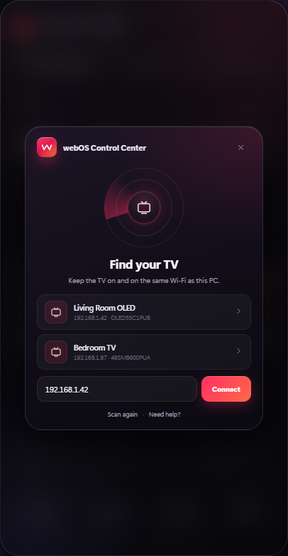
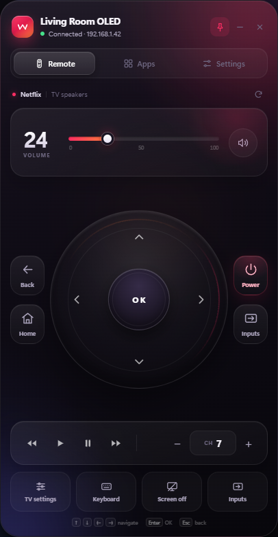

# webOS Control Center

A small, always-on-top control center for LG webOS TVs, built for Windows 11.
It talks to the TV directly over your Wi-Fi — no cloud, no account, no phone app.

| First run | Remote |
|---|---|
|  |  |

## What it can do

- **Volume** — slider with live feedback, mute, volume up/down
- **Channels** — channel up/down, on-screen keypad for direct channel entry
- **D-pad** — up / down / left / right / OK, with press-and-hold repeat
- **Magic Remote pointer** — drag the ring around the D-pad to move the cursor, scroll to browse
- **Media** — rewind, play, pause, fast forward
- **Apps** — real app list from the TV, brand artwork, search, custom app IDs
- **Inputs** — Live TV and every HDMI input the TV reports
- **TV settings** — opens the TV's own settings menu
- **Keyboard** — send text to a focused search/text field on the TV
- **Power** — turn off, screen off, and **Wake-on-LAN** to turn it back on
- **Extras** — always on top, launch at login, close to tray, auto reconnect
- **Global hotkey** — `Ctrl+Alt+W` shows/hides the widget from anywhere

## Requirements

| | |
|---|---|
| PC | Windows 10 or 11, Node.js 18+ |
| TV | LG webOS TV (2016 or newer works best) |
| Network | PC and TV on the same Wi-Fi / LAN |
| TV setting | *Settings → Connection → Mobile Connection Management → TV On With Mobile* enabled (needed for Wake-on-LAN) |

## Run it

```bat
cd webos-control-center
npm install
npm start
```

On the **first launch**, Electron downloads its own runtime (~100 MB) automatically. That needs an
internet connection once; after that the widget starts offline. `Start WebOS Control Center.bat`
does the same thing — it installs dependencies and downloads the runtime if they are missing.

A widget appears near the right edge of your screen. If this PC has never been paired, it opens the
**Find your TV** screen and waits — it never connects to a TV on its own.

### First-time pairing

1. On the TV: **Settings → Connection → Wi-Fi connection → Advanced Wi-Fi settings** — note the IP address.
2. In the widget, type the IP (for example `192.168.1.42`) and press **Connect**.
   - Or press **Scan again**; it searches via SSDP and a quick local port scan.
3. A pairing prompt appears on the TV. Choose **Allow** with the TV remote.
4. Done. The IP and client key are saved, so next launches connect automatically.

The pairing is only stored after the TV accepts it. If an IP is wrong or the prompt is declined,
nothing is saved and the next launch asks again.

> If no prompt appears, the TV may have **LG Connect Apps** disabled. On older TVs it sits under
> *Settings → Network → LG Connect Apps*. On newer TVs the prompt appears automatically on first connect.

## Everyday use

- Drag the header to move the widget; its position is remembered.
- The pin button (top right) toggles always-on-top.
- Close (**×**) hides it to the tray while **Close to tray** is on (the tray notification tells you).
  Turn that setting off, or use **Settings → This widget → Quit widget**, to exit completely.
  You can also right-click the tray icon and choose **Quit**.
- `Ctrl+Alt+W` toggles the widget globally.

### Keyboard shortcuts

| Key | Action |
|---|---|
| `↑ ↓ ← →` | D-pad |
| `Enter` | OK |
| `Esc` / `Backspace` | Back |
| `H` | Home |
| `M` | Mute |
| `+` / `-` | Volume up / down |

## Wake-on-LAN

Wake-on-LAN lets the widget power the TV on while the TV is in standby.

1. Connect to the TV once — the widget looks up the MAC address automatically.
2. If it could not, find the MAC on the TV (*Settings → Connection → Wired/Wi-Fi connection → Advanced*) and paste it in **Settings → Wake on LAN**.
3. Enable **TV On With Mobile** on the TV and keep the TV connected to Wi-Fi (do not unplug it from power).
4. Press **Wake TV** in the widget or from the tray.

Wake sends magic packets to ports 9 and 7 on the broadcast address of your subnet. If it still fails:

- Make sure the PC and TV are on the same subnet (for example both `192.168.1.x`).
- Allow Node.js/Electron through Windows Firewall for **private** networks.
- Some routers block broadcast between Wi-Fi clients ("AP isolation"); disable it for the TV's network.

## Troubleshooting

| Symptom | Fix |
|---|---|
| No TV found by scan | Type the IP manually. Windows Firewall may block SSDP/port 3000 — allow Electron on private networks. |
| TV closes the connection, no pairing prompt | The widget tries the secure endpoint (`wss://<tv-ip>:3001`) first and falls back to `ws://<tv-ip>:3000`. If it still fails, run `npm run diagnose -- <tv-ip>` and check the TV's **TV On With Mobile** setting. |
| `ECONNREFUSED` / no answer | TV is off or asleep; press **Wake TV**. Check the IP did not change (give the TV a DHCP reservation). |
| Pairing prompt never shows | Enable **TV On With Mobile** on the TV. On older models enable **LG Connect Apps**. |
| Pairing was declined | Press **Connect** again and choose **Allow** on the TV within ~90 seconds. |
| App list is empty | The TV did not answer `listLaunchPoints`; press the refresh button on the Apps tab. |
| Every button returns `401 insufficient permissions` | Update to the current build and reconnect. webOS 26 (firmware 43.x+) ignores the old signed registration manifest, so the widget now registers with an unsigned manifest that requests the permissions explicitly. Run `npm run diagnose -- <tv-ip> <client-key>` to confirm they are granted. |
| Some buttons do nothing | Not every webOS version exposes every command (e.g. screen-off on older models). The rest of the remote still works. |
| Widget is too large/small | It scales itself to your screen height. For unusual DPI setups, adjust `BASE_HEIGHT` in `src/main.js`. |
| It seems to come back after I close it | With **Close to tray** on, the **×** button only hides the window. Use **Settings → This widget → Quit widget** or the tray menu's **Quit**. If it still starts with Windows, turn off **Launch at login**. |

## Your data

Everything stays on this PC:

- Config and pairing key: `%APPDATA%\webOS Control Center\config.json`
- Running from source (for example `npm start` or `Start WebOS Control Center.bat`) uses
  `%APPDATA%\webOS Control Center Dev\config.json` instead, so it never inherits or overwrites an
  installed copy's pairing. Both start with onboarding when no TV has been paired.
- The widget only opens a local WebSocket to your TV (`wss://<tv-ip>:3001`, or `ws://<tv-ip>:3000` on older sets) and sends SSDP/ARP/UDP on your LAN.
- No telemetry, no external servers.

Use **Settings → This widget → Forget TV** to remove the pairing key.

## Development

```bat
npm run preview   :: open http://127.0.0.1:4173 in a browser (mock TV, no Electron)
npm run check     :: syntax-check every source file
npm run diagnose -- 192.168.1.42   :: probe ports, transports, pointer socket, permissions
npm run icons     :: regenerate assets/icon.png and assets/icon.ico
```

Project layout:

```
src/
  main.js              Electron main process, window, tray, IPC
  preload.js           contextBridge API (window.webos)
  lib/
    lgtv.js            LG SSAP client: register/pair, requests, pointer socket
    discovery.js       SSDP discovery + local port-3000 scan
    wol.js             Wake-on-LAN magic packets + ARP MAC lookup
  renderer/
    index.html         UI structure
    styles.css         design system and animations
    app.js             state, rendering, commands, sheets, setup
    apps.js            app artwork, catalog, sorting
    mock.js            browser-only fake TV used by `npm run preview`
scripts/
  make-icons.js        generates the app/tray icons
  preview-server.js    tiny static server for previewing the UI
```

### Packaging (optional)

Build a portable Windows folder:

```bat
npm run package:win
```

The result is `dist/webOS Control Center-win32-x64/`. Create a desktop shortcut to
`webOS Control Center.exe` — or use `Start WebOS Control Center.bat` for the dev version.

## Notes

- Built with Electron 45, plain HTML/CSS/JS, and no runtime dependencies besides `ws`.
- The registration manifest lists the second-screen permissions in the outer block (webOS 26 ignores the old signed `com.lge.test` manifest and silently withholds them).
- Animations respect **Reduce motion** in Windows accessibility settings.

## Contributing

Issues and pull requests are welcome. Run `npm run check` before opening a PR, and keep the
UI dependency-free (plain HTML/CSS/JS).

## License

MIT — see [LICENSE](LICENSE).
